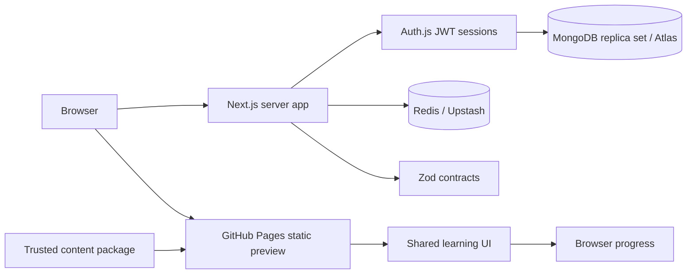

# Architecture and implementation boundaries

## Runtime boundary

MongoDB, authentication, and cache imports stay out of `apps/preview`. The preview consumes the editorial content package at build time; only its browser-safe roadmap entry point is imported by client components. `contracts` provides browser-safe schemas and public types. `database` and `platform` are server-only dependencies of the full application. Auth and MongoDB routes use the Node runtime, which can run in containers or serverless Node functions; they do not assume an Edge runtime can host Mongoose or bcrypt.

Server Components load authentication and project cached lessons into safe public props. The shared interactive workspace uses Zustand for bounded local progress and bookmarks, TanStack Query for private account progress and grading requests, Radix for dialogs and focus control, Framer Motion for feedback, and Lenis for scrolling. Motion follows the reduced-motion preference. A static adapter grades educational preview exercises locally; the server adapter submits answers to the grading API.

## Data design

- `users`: unique normalized email, optional unique Google subject, credential hash excluded from reads, role, CEFR level, XP, streak, activity timestamp, session version, suspension date, audit timestamps.
- `topics`: unique slug; compound level/category/slug index; complete notes and rules; exactly five exercises with unique UUIDs and ordered positions. Answer and explanation subfields are excluded from ordinary reads. Application boundaries must also use `toPublicExercise` to avoid accidentally returning secrets from freshly created documents.
- `user_progress`: compound unique `(userId, topicId)` index for indexed point lookups; user/status/update index for dashboard lists; a bounded best-result array, aggregate score, attempts, and revision. Completion validation requires all five results correct. Indexed MongoDB lookups use B-trees, not literal constant-time lookup.
- `exercise_attempts`: bounded per-document attempt events, unique user/idempotency key, user/topic/time query index, and an expiry index. The grading service assigns a 30-day retention date and stores the committed response for safe retries. This avoids growing the progress document indefinitely.

Zod validates content before insertion. Mongoose save validation reinforces invariants. Grading updates progress, XP, streaks, and attempt records in one MongoDB transaction. Other query mutations must also validate through the Zod contracts: Mongoose document hooks do not run for every query update. `ensureIndexes` explicitly creates indexes without dropping existing ones. Run it as a deployment migration before accepting traffic; runtime auto-index creation is disabled.

The database connection promise and pool are reused across warm invocations, with a pool maximum of 10 and bounded idle/selection timeouts. A failed first connection can be retried. Atlas connection limits still require deployment concurrency and pool budgeting; serverless scaling is not unlimited by itself.

## Authentication and trust

Password credentials use bcrypt cost 12, minimum 12 characters, and a 72 UTF-8 byte ceiling. Registration rejects injected roles and unknown fields, bounds request-body size, and gives the same response for existing emails. Unknown users still receive an expensive password comparison. Google requires a verified email and matching stable provider subject. There is no automatic email-based linking to an existing password account.

Auth.js uses encrypted JWT session cookies with a seven-day maximum age and its CSRF protections. Middleware adds a nonce-based CSP; authenticated HTML is dynamically rendered. Each session check reloads role/suspension/session version from MongoDB, trading an indexed read for immediate role changes and revocation. Increment `sessionVersion` through a trusted administrative process to revoke all sessions. No public endpoint can grant an admin role. Email/password registration does not yet verify mailbox ownership.

Mutation routes require the exact configured origin, and no cross-origin CORS access is granted. Authentication read/write endpoints and registration use atomic Redis fixed-window limits. Credentials additionally have an email-derived limiter, preventing IP rotation from bypassing per-account limits. Limiting fails closed when Redis is unavailable. Responses never expose raw upstream errors. Logs use generated request IDs and omit bodies, cookies, tokens, and connection strings.

`TRUST_PROXY=false` is the safe default: network limits share a fallback bucket, which is conservative but unsuitable for high-traffic public use. Enable it only when your ingress **replaces** incoming `X-Forwarded-For` with a trusted client IP; otherwise user-controlled headers could bypass limits. `APP_ORIGIN` and `AUTH_URL` must agree. Public production requires HTTPS; HTTP is accepted only for loopback development. Production CSP allows inline styles for Tailwind/motion compatibility but requires script nonces. Preview security headers depend on GitHub Pages and are not equivalent to the server app's headers.

## Learning behavior and rendering

The 37-lesson curriculum covers eight paths, with a suggested progression and five exercises per topic. All topics are accessible; prerequisites are teaching guidance rather than forced locks. Notes include GFM tables, callouts, native disclosures, audio cues, interactive checklists, and flashcards. The reader skips arbitrary HTML and never compiles stored MDX.

The server checks topic/exercise membership and validates each answer payload. Each newly mastered exercise earns 10 XP; completing a topic for the first time adds 50 XP. Wrong answers never erase mastery, and retries or later repetitions do not award it again. A unique user/attempt identifier protects repeated requests; conflicting payloads return 409. Streaks use UTC calendar days and update atomically with the attempt. Private progress responses use no-store.

Redis caches public lesson projections for 300 seconds. Public JSON also allows a five-minute shared edge cache. Content-cache failures fall back to MongoDB; rate limits fail closed. The full app uses a dynamic nonce-bearing shell for its authenticated workspace; the Pages shell is statically exported. Native per-lesson ISR routes would require a separate policy from the dynamic nonce shell and are not claimed by this release.

The static edition intentionally includes educational answer keys for local grading. Guest progress, bookmarks, and daily goals persist on the current device. The authenticated server edition keeps answer keys on the server and stores learning progress in MongoDB; bookmarks and daily goals remain device preferences. Charts show the latest 500 practice events while cumulative XP and mastery remain authoritative totals.
