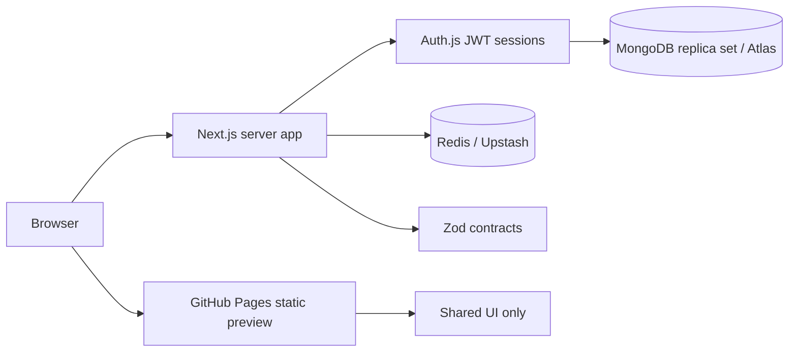

# Architecture and implementation boundaries

## Runtime boundary

All server/database imports stay out of `apps/preview`. Shared UI depends only on React/UI libraries. `contracts` contains browser-safe pure schemas; `database` and `platform` are server-only dependencies of the server application. Auth and MongoDB routes use the Node runtime, which can run in containers or serverless Node functions; they do not assume an Edge runtime can host Mongoose or bcrypt.

The app uses React Server Components. Client boundaries are limited to interactive auth forms and sign-out. The final exercise store (Zustand), query cache (TanStack Query), and motion/Lenis interactions will be added with the exercise UI. Dependencies are installed; no fake stores, grading APIs, or content are present.

## Data design

- `users`: unique normalized email, optional unique Google subject, credential hash excluded from reads, role, CEFR level, XP, streak, activity timestamp, session version, suspension date, audit timestamps.
- `topics`: unique slug; compound level/category/slug index; complete notes and rules; exactly five exercises with unique UUIDs and ordered positions. Answer and explanation subfields are excluded from ordinary reads. Application boundaries must also use `toPublicExercise` to avoid accidentally returning secrets from freshly created documents.
- `user_progress`: compound unique `(userId, topicId)` index for indexed point lookups; user/status/update index for dashboard lists; a bounded latest result array, aggregate score, attempts, and revision for future optimistic concurrency. Completion validation requires all five results correct. Indexed MongoDB lookups use B-trees, not literal constant-time lookup.
- `exercise_attempts`: bounded per-document attempt events, unique user/idempotency key, user/topic/time query index, and an expiry index. The grading service must assign retention dates. This avoids growing the progress document indefinitely.

Zod validates content before insertion. Mongoose save validation reinforces invariants. Future query updates must validate through the Zod contracts and apply progress/mastery changes inside a transaction: Mongoose document hooks do not run for every query update. `ensureIndexes` explicitly creates indexes without dropping existing ones. Run it as a deployment migration before accepting traffic; runtime auto-index creation is disabled.

The database connection promise and pool are reused across warm invocations, with a pool maximum of 10 and bounded idle/selection timeouts. A failed first connection can be retried. Atlas connection limits still require deployment concurrency and pool budgeting; serverless scaling is not unlimited by itself.

## Authentication and trust

Password credentials use bcrypt cost 12, minimum 12 characters, and a 72 UTF-8 byte ceiling. Registration rejects injected roles and unknown fields, bounds request-body size, and gives the same response for existing emails. Unknown users still receive an expensive password comparison. Google requires a verified email and matching stable provider subject. There is no automatic email-based linking to an existing password account.

Auth.js uses encrypted JWT session cookies with a seven-day maximum age and its CSRF protections. Middleware adds a nonce-based CSP; authenticated HTML is dynamically rendered. Each session check reloads role/suspension/session version from MongoDB, trading an indexed read for immediate role changes and revocation. Increment `sessionVersion` through a trusted administrative process to revoke all sessions. No public endpoint can grant an admin role. Email/password registration does not yet verify mailbox ownership.

Mutation routes require the exact configured origin, and no cross-origin CORS access is granted. Authentication read/write endpoints and registration use atomic Redis fixed-window limits. Credentials additionally have an email-derived limiter, preventing IP rotation from bypassing per-account limits. Limiting fails closed when Redis is unavailable. Responses never expose raw upstream errors. Logs use generated request IDs and omit bodies, cookies, tokens, and connection strings.

`TRUST_PROXY=false` is the safe default: network limits share a fallback bucket, which is conservative but unsuitable for high-traffic public use. Enable it only when your ingress **replaces** incoming `X-Forwarded-For` with a trusted client IP; otherwise user-controlled headers could bypass limits. `APP_ORIGIN` and `AUTH_URL` must agree. Public production requires HTTPS; HTTP is accepted only for loopback development. Production CSP allows inline styles for Tailwind/motion compatibility but requires script nonces. Preview security headers depend on GitHub Pages and are not equivalent to the server app's headers.

## Upcoming stages

3. Seed three complete, reviewed grammar topics, with exactly five exercises each. User-supplied notes can be used here.
4. Add cached topic reads with safe projections, transactional/idempotent grading, XP, streaks, and progress. Cache lesson data with revalidation while preserving a nonce-bearing dynamic application shell; review public lesson HTML/ISR policy before introducing static route output.
5. Build the full kinetic landing page, learning dashboard, and split-screen exercise experience, with reduced-motion support and accessible keyboard alternatives.

The current shared foundation page exists to test routing, typography, deployment, and auth entry points. It is not the completed learning interface.
